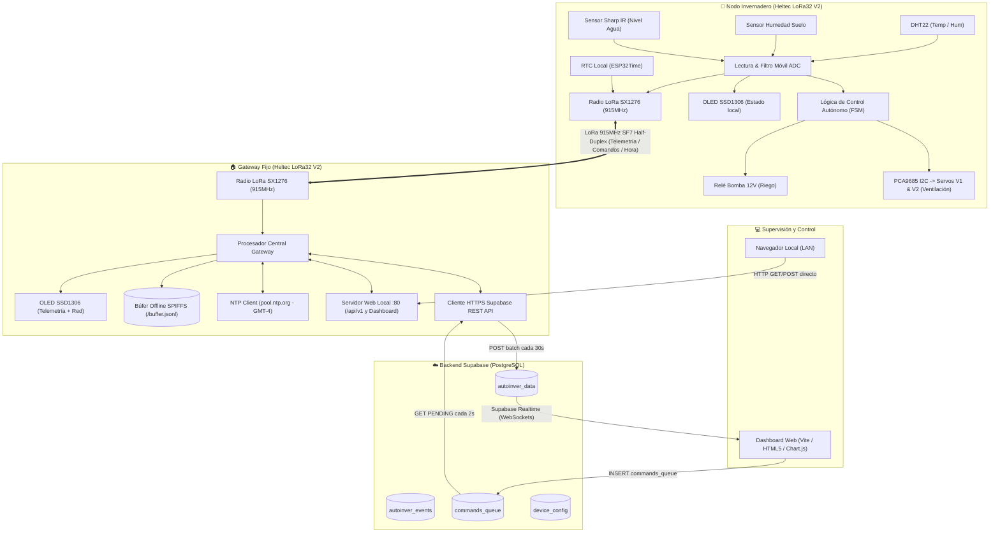

# 🌿 AUTOINVER v2.0 - Flujo Integral del Sistema y Arquitectura

Documento técnico descriptivo que detalla la arquitectura completa, todas las partes involucradas, el ciclo de vida de los datos, los mecanismos de tolerancia a fallos y los protocolos de comunicación del proyecto **AUTOINVER**.

---

## 📑 Tabla de Contenidos
1. [Visión General del Sistema](#1-visión-general-del-sistema)
2. [Diagrama de Arquitectura de Extremo a Extremo](#2-diagrama-de-arquitectura-de-extremo-a-extremo)
3. [Componentes y Partes Involucradas](#3-componentes-y-partes-involucradas)
   - [3.1 Nodo Invernadero (Móvil / Campo)](#31-nodo-invernadero-móvil--campo)
   - [3.2 Enlace de Radio LoRa 915 MHz](#32-enlace-de-radio-lora-915-mhz)
   - [3.3 Gateway Estación Base (Puente LoRa-WiFi-Cloud)](#33-gateway-estación-base-puente-lora-wifi-cloud)
   - [3.4 Backend en la Nube (Supabase / PostgreSQL)](#34-backend-en-la-nube-supabase--postgresql)
   - [3.5 Frontend / Dashboard de Monitoreo y Control](#35-frontend--dashboard-de-monitoreo-y-control)
4. [Flujos de Operación Paso a Paso](#4-flujos-de-operación-paso-a-paso)
   - [Flujo 1: Arranque y Sincronización Temporal (NTP -> LoRa -> RTC)](#flujo-1-arranque-y-sincronización-temporal-ntp---lora---rtc)
   - [Flujo 2: Muestreo y Lógica Autónoma de Control Local (FSM)](#flujo-2-muestreo-y-lógica-autónoma-de-control-local-fsm)
   - [Flujo 3: Telemetría y Subida de Datos (Nodo -> Gateway -> Supabase)](#flujo-3-telemetría-y-subida-de-datos-nodo---gateway---supabase)
   - [Flujo 4: Resiliencia Offline (Búfer SPIFFS en Gateway)](#flujo-4-resiliencia-offline-búfer-spiffs-en-gateway)
   - [Flujo 5: Envío y Ejecución de Comandos Remotos](#flujo-5-envío-y-ejecución-de-comandos-remotos)
   - [Flujo 6: Visualización en Tiempo Real en el Dashboard](#flujo-6-visualización-en-tiempo-real-en-el-dashboard)
5. [Protocolo de Comunicación LoRa](#5-protocolo-de-comunicación-lora)
6. [Mapeo de Hardware y Pines](#6-mapeo-de-hardware-y-pines)
7. [Mecanismos de Seguridad y Failsafes](#7-mecanismos-de-seguridad-y-failsafes)

---

## 1. Visión General del Sistema

**AUTOINVER v2.0** es un sistema IoT distribuido para el monitoreo y control automatizado de invernaderos agrícolas. Está diseñado con una premisa clave: **autonomía local con supervisión remota**. 

El invernadero opera de forma totalmente independiente incluso si no hay conexión a Internet o señal WiFi en la zona de cultivo, comunicándose mediante radiofrecuencia LoRa de largo alcance (915 MHz) con una estación base (Gateway). El Gateway actúa como puente inteligente que retransmite telemetría a la nube (Supabase), almacena datos en flash cuando se pierde la conexión de red y sincroniza la hora y comandos hacia el nodo.

---

## 2. Diagrama de Arquitectura de Extremo a Extremo



---

## 3. Componentes y Partes Involucradas

### 3.1 Nodo Invernadero (Móvil / Campo)
- **Controlador:** Heltec WiFi LoRa 32 V2 (ESP32 dual core + LoRa SX1276 + pantalla OLED 0.96").
- **Sensores:**
  - `DHT22`: Temperatura (-40 a 80 °C) y humedad relativa ambiental (0-100%).
  - `Sensor de Suelo Capacitivo`: Medición de humedad por variación dieléctrica, conectado a canal ADC con media móvil de 8 muestras.
  - `Sharp 2Y0A21 (IR)`: Medición de distancia a la superficie del agua en el estanque (nivel porcentual 0-100%).
- **Actuadores:**
  - `Driver PCA9685 (I2C)`: Controlador PWM de 16 canales que pilota 2 servomotores para apertura/cierre proporcional de compuertas de ventilación (A y B). Comparte el bus I2C (GPIO 4 y 15) con el OLED.
  - `Módulo Relé (GPIO 12)`: Conmutación de bomba sumergible de 12V DC para riego.
- **Persistencia NVS (Preferences):** Guarda umbrales de calibración de sensores y rangos mínimos/máximos de servos en memoria flash no volátil.

### 3.2 Enlace de Radio LoRa 915 MHz
- **Parámetros RF:** Frecuencia 915.0 MHz, Spreading Factor (SF) 7, Ancho de Banda (BW) 125 kHz, Coding Rate (CR) 4/5, Potencia TX 17 dBm con CRC activado.
- **Topología:** Punto a punto (P2P), Half-Duplex.
- **Contenido del enlace:** Telemetría periódica del invernadero (cada 5 segundos), sincronización de tiempo desde el Gateway y recepción de comandos asíncronos.

### 3.3 Gateway Estación Base (Puente LoRa-WiFi-Cloud)
- **Controlador:** Heltec WiFi LoRa 32 V2 ubicado en la vivienda o estación con cobertura WiFi e Internet.
- **Módulos de Software Activos:**
  - `LoRa Transceiver`: Recibe paquetes del nodo, extrae RSSI/SNR y envía tramas de sincronización y comandos.
  - `Gestión WiFi con Jerarquía de Prioridad`:
    - 🥇 **Prioridad 1 (Nativa fija):** Red `geogo_IoT` (clave `2iot2025`). El gateway siempre intentará conectar a esta red primero.
    - 🥈 **Prioridad 2 (Respaldo fijo / Hotspot móvil):** Red `amarox_555` (clave `queteimporta123`). Se conecta si la red `geogo_IoT` no está disponible. Ideal para presentaciones y demostraciones en terreno compartiendo internet desde el teléfono móvil.
    - 🥉 **Prioridad 3 (Personalizada en Flash NVS):** Red adicional configurable desde el portal.
  - `Portal Cautivo (Modo AP + DNS Server)`:
    - Si ninguna de las redes WiFi se conecta, activa automáticamente el punto de acceso `Autoinver_Gateway_AP` en `192.168.4.1`.
    - Redirección cautiva automática (Android, iOS CNA, Windows NCSI).
    - **Seguridad:** Acceso protegido con usuario y contraseña (por defecto: `admin` / `admin`, actualizable desde el portal).
    - **Escáner WiFi integrado:** Permite escanear redes 2.4 GHz en vivo y seleccionar con un solo clic.
  - `Cliente NTP`: Obtiene la hora oficial desde servidores de red horario Chile Continental (GMT-4).
  - `Servidor Web Local (Puerto 80)`: Expone endpoints REST (`/api/v1/*`), el Dashboard local (`/dashboard`) y el Portal de Configuración (`/portal`).
  - `Gestor de Búfer SPIFFS`: Almacena hasta 500 registros JSON en archivo flash `/buffer.jsonl` si Internet se cae.
  - `Supabase Client`: Realiza inserciones en lotes (Batch POST de hasta 20 registros) hacia PostgREST en Supabase vía HTTPS TLS. Consulta comandos pendientes cada 2 segundos.

### 3.4 Backend en la Nube (Supabase / PostgreSQL)
- **Base de Datos PostgreSQL:**
  - `autoinver_data`: Almacén histórico de telemetría (temperatura, humedad ambiente, suelo, nivel de agua, estado bomba, posición servos, RSSI).
  - `autoinver_events`: Registro de auditoría de eventos relevantes (arranque de bomba, cortes de emergencia, cambios de modo).
  - `commands_queue`: Cola transaccional para control remoto (`PENDING` -> `SENT` -> `ACK` -> `FAILED`).
  - `device_config`: Configuración dinámica remota por dispositivo.
- **Supabase Realtime:** Difusión mediante WebSockets hacia navegadores web conectados cada vez que entra un registro a `autoinver_data`.

### 3.5 Frontend / Dashboard de Monitoreo y Control
- **Implementación dual:**
  1. *Dashboard Central Cloud (`dashboard/index.html`):* Diseñado para hosting estático (GitHub Pages, Vercel, Netlify). Consume Supabase JS SDK, visualiza gráficos históricos con `Chart.js`, escucha eventos por Supabase Realtime y publica comandos en `commands_queue`.
  2. *Dashboard Embebido del Gateway (`/dashboard`):* Servido directamente desde la memoria flash del ESP32 del Gateway, permitiendo monitoreo y control en red local incluso si no hay conexión a Internet.

---

## 4. Flujos de Operación Paso a Paso

### Flujo 1: Arranque y Sincronización Temporal (NTP -> LoRa -> RTC)
```
[Gateway] --(WiFi)--> Consulta Servidor NTP pool.ntp.org
[Gateway] <-- Actualiza su RTC interno con época Unix (GMT-4)
     │
[Nodo] Al arrancar no tiene hora exacta (usa fecha de compilación como base)
[Nodo] --(LoRa: "REQ:HORA")--> [Gateway]
[Gateway] --(LoRa: "SYNC:HORA|YYYY-MM-DD_HH:MM:SS")--> [Nodo]
[Nodo] Actualiza su chip RTC interno (ESP32Time) y pasa a estado SYNC_OK
```

### Flujo 2: Muestreo y Lógica Autónoma de Control Local (FSM)
Cada **2 segundos** (`SENSOR_INTERVAL_MS`), el Nodo ejecuta:
1. **Lectura y Filtrado:** Lee DHT22 y muestras ADC de suelo e infrarrojo. Aplica filtro de media móvil sobre las últimas 8 muestras para eliminar ruido eléctrico.
2. **Control Térmico (Ventilación):**
   - Si $T > 32.0^\circ\text{C}$ (`tempThresh2`): Abre ambas compuertas (Servo 1 y Servo 2 a 90°).
   - Si $T > 28.0^\circ\text{C}$ (`tempThresh1`): Abre solo compuerta A (Servo 1 a 90°, Servo 2 a 0°).
   - Si $T < (28.0^\circ\text{C} - 1.5^\circ\text{C})$ (Histeresis): Cierra ambas compuertas (0°).
3. **Control de Riego Inteligente:**
   - **Condición de activación:** Humedad de suelo < 40% (`soilThresh`) **Y** nivel de agua en estanque > 10% (`WATER_MIN_PCT`). Activa relé de la bomba.
   - **Condición de apagado:** Humedad de suelo alcanza 50% (umbral + histéresis de 10%).
   - **Temporizador de seguridad:** Si la bomba supera 10 segundos continuos (`pumpDuration`), se apaga automáticamente por timeout para evitar inundaciones.
   - **Bloqueo de seguridad:** Si el nivel de agua cae bajo el 10%, la bomba se bloquea o apaga inmediatamente (anti-dry run) para no quemar el motor.

### Flujo 3: Telemetría y Subida de Datos (Nodo -> Gateway -> Supabase)
Cada **5 segundos** (`TX_INTERVAL_MS`):
```
1. Nodo arma payload ASCII:
   "ID:AUTOINVER|TS:2026-10-07_16:00:00|TEMP:24.5|HUM:65.2|SOIL:1820|WATER:2100|WLVL:82.0|S1:0|S2:0|PUMP:0|MODE:AUTO|RSSI:-68|CNT:142"

2. Nodo emite por LoRa a 915 MHz.

3. Gateway recibe la trama:
   - Extrae RSSI y SNR de recepción.
   - Parsea los campos a una estructura de datos en memoria.
   - Guarda una copia formateada en JSON en el búfer SPIFFS local (/buffer.jsonl).

4. Gateway cada 30 segundos (SUPABASE_SEND_MS):
   - Vacía el búfer de SPIFFS hacia Supabase.
   - Genera una llamada HTTP POST a https://[proyecto].supabase.co/rest/v1/autoinver_data.
   - Envía los datos en un array JSON (Batch) de hasta 20 registros por petición.
```

### Flujo 4: Resiliencia Offline (Búfer SPIFFS en Gateway)
Si el Gateway pierde conexión WiFi o Internet:
1. Las tramas LoRa del nodo siguen llegando sin problema.
2. Cada registro se almacena secuencialmente en el archivo `/buffer.jsonl` de la memoria SPIFFS (con rotación de seguridad que conserva los últimos 500 registros).
3. El display OLED del Gateway muestra `WiFi:--` y marca el indicador `B` (Buffer con datos pendientes).
4. El servidor Web local del Gateway sigue funcionando en la red local (si hay router LAN sin Internet).
5. En cuanto se restablece la conexión WiFi/Internet, el Gateway ejecuta `flushBufferToSupabase()`, enviando todos los lotes atrasados preservando las marcas de tiempo originales.

### Flujo 5: Envío y Ejecución de Comandos Remotos
Existen dos rutas para mandar comandos al invernadero:

#### Ruta A: Vía Nube (Supabase)
```
[Usuario en Dashboard Web]
          │ Clic en "Encender Bomba" o mover slider de compuerta
          ▼
Inserta fila en `commands_queue` (action: 'BOMBA', value: '1', status: 'PENDING')
          │
          │ Cada 2 segundos: Gateway consulta REST GET de comandos PENDING
          ▼
[Gateway] Descarga comando y arma trama LoRa:
          "CMD:AUTOINVER|ACT:BOMBA|VAL:1|TS:2026-10-07_16:00:02"
          │
          ▼ LoRa 915MHz
[Nodo] Recibe comando:
       - Cambia a MODE_MANUAL con override de 10 minutos.
       - Acciona el hardware (conmuta relé o posiciona servos).
       - Registra ACK en su siguiente paquete de telemetría: "|ACK:BOMBA".
          │
[Gateway] Actualiza Supabase: PATCH `commands_queue` -> status: 'ACK'.
```

#### Ruta B: Vía Gateway Local (Fallback sin Internet)
El usuario abre `http://[IP_GATEWAY]/dashboard` o envía un `POST /api/v1/command` con parámetros `act=BOMBA&val=1`. El Gateway emite la trama LoRa de inmediato al nodo.

---

## 5. Protocolo de Comunicación LoRa

Todas las tramas son cadenas ASCII delimitadas por el carácter tubería `|` para facilitar la inspección visual en consola serial y ahorrar sobrecarga de bytes en el aire:

| Tipo de Mensaje | Dirección | Formato de Trama |
|---|---|---|
| **Telemetría** | Nodo $\rightarrow$ GW | `ID:AUTOINVER\|TS:<timestamp>\|TEMP:<t>\|HUM:<h>\|SOIL:<adc>\|WATER:<adc>\|WLVL:<pct>\|S1:<deg>\|S2:<deg>\|PUMP:<0/1>\|MODE:<modo>\|RSSI:<rssi>\|CNT:<cnt>[\|ACK:<act>]` |
| **Petición Hora** | Nodo $\rightarrow$ GW | `REQ:HORA` |
| **Respuesta Hora**| GW $\rightarrow$ Nodo | `SYNC:HORA\|YYYY-MM-DD_HH:MM:SS` |
| **Comando Actuador** | GW $\rightarrow$ Nodo | `CMD:AUTOINVER\|ACT:<BOMBA\|S1\|S2\|MODE\|CAL>\|VAL:<valor>\|TS:<timestamp>` |

---

## 6. Mapeo de Hardware y Pines

### Nodo Invernadero (Heltec LoRa32 V2)
| Periférico | Pin / Bus | Función |
|---|---|---|
| **DHT22** | GPIO 25 | Entrada digital con resistencia pull-up para sensor ambiental |
| **Humedad Suelo** | GPIO 33 | Entrada analógica ADC1 para sensor capacitivo |
| **Sharp 2Y0A21** | GPIO 32 | Entrada analógica ADC1 para sensor de nivel de agua |
| **Relé Bomba** | GPIO 12 | Salida digital Active HIGH para compuerta del relé |
| **OLED + PCA9685**| GPIO 4 (SDA), GPIO 15 (SCL) | Bus I2C compartido (OLED `0x3C`, PCA9685 `0x40`) |
| **LoRa SX1276** | GPIO 5 (SCK), 19 (MISO), 27 (MOSI), 18 (CS), 14 (RST), 26 (IRQ) | Bus SPI interno de la placa Heltec |

> **Nota técnica sobre hardware:** El pin GPIO 21 en la placa Heltec LoRa32 V2 controla la línea interna de alimentación `Vext` y no debe utilizarse como SDA para no cortar la energía a los periféricos. Por ello, el PCA9685 y el OLED comparten exitosamente los pines 4 y 15.

### Gateway Estación Base (Heltec LoRa32 V2)
| Periférico | Pin / Bus | Función |
|---|---|---|
| **OLED Display** | GPIO 4 (SDA), 15 (SCL), 16 (RST) | Monitoreo visual de estado de red, buffer y paquetes |
| **LoRa SX1276** | GPIO 5 (SCK), 19 (MISO), 27 (MOSI), 18 (CS), 14 (RST), 26 (IRQ) | Transmisor y receptor de radio |
| **WiFi / BLE** | Antena integrada / Chip ESP32 | Enlace a router WiFi 2.4 GHz |
| **Flash SPIFFS**| Memoria interna ESP32 | Almacén no volátil para archivo `/buffer.jsonl` |

---

## 7. Mecanismos de Seguridad y Failsafes

1. **Protección de Bomba en Seco (Anti-Dry Run):** La función `activatePump()` evalúa si `waterPct < 10%`. Si no hay agua, bloquea el encendido. Si el agua se agota durante el riego, ejecuta un corte de emergencia inmediato.
2. **Límite de Tiempo de Riego (Pump Watchdog):** Riego automático o manual se corta inexorablemente a los 10 segundos (`pumpDuration = 10000 ms`) para prevenir anegamientos por falla de sensor.
3. **Histéresis Térmica y de Humedad:** Previene el desgaste mecánico de los servos y reles evitando activaciones oscilatorias continuas en valores frontera.
4. **Override Manual con Expiración:** Tras recibir un comando manual (`S1`, `S2` o `BOMBA`), el sistema opera en modo manual durante 10 minutos (`MANUAL_OVERRIDE_MS`) y luego regresa de forma autónoma al modo `AUTO`.
5. **Aislamiento de Fallo Cloud:** Si Supabase o Internet caen, el invernadero sigue funcionando al 100% en campo y el Gateway resguarda todas las lecturas en SPIFFS.
